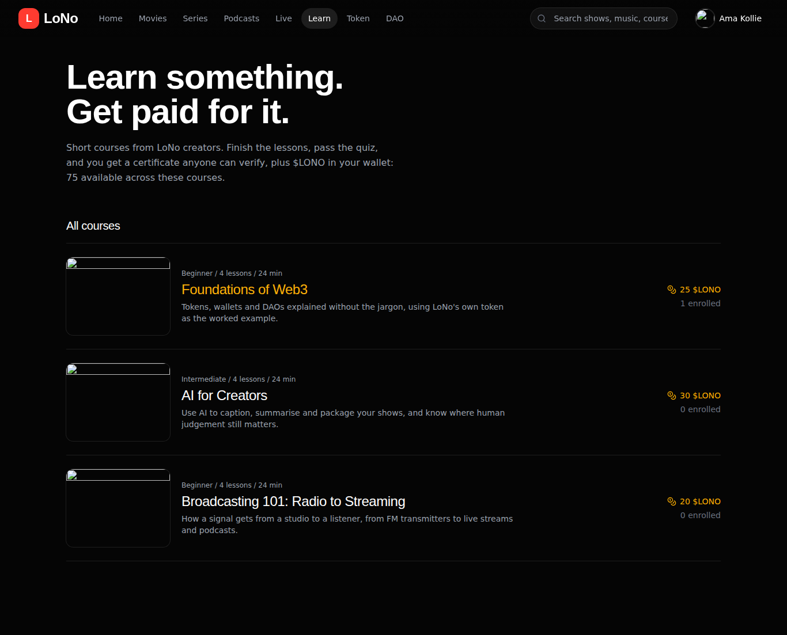
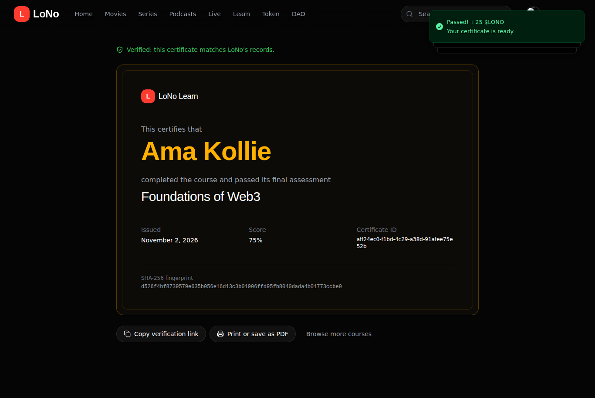
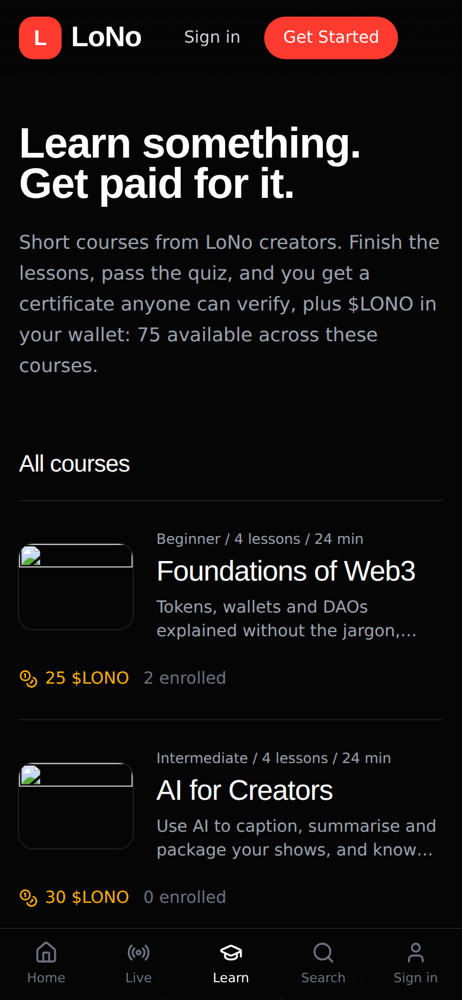

# LoNo

Streaming TV, radio, podcasts, music and courses in one app, with creator channels and a
simulated utility token ($LONO) that viewers earn by watching and learning, then stake and vote with.

| Learn | Certificate | Mobile |
|---|---|---|
|  |  |  |

- **Backend:** FastAPI + MongoDB (Motor), in `backend/`
- **Frontend:** React 19 + Tailwind + shadcn/ui, in `frontend/`
- **Version:** 2.0, rebuilt from the original Emergent prototype so it runs anywhere

## Run it

### Quickest: the launcher (needs Python 3.10+)

| | Windows | macOS / Linux |
|---|---|---|
| Run locally | double-click `start.cmd` | `./start.sh` |
| Run with Docker | `start.cmd -Docker` | `./start.sh --docker` |

Local mode opens **http://localhost:8001**. Docker mode serves **http://localhost:8080**.
Keep the window open while you use the app.

The launcher sets up everything it needs on the first run:
- a Python virtual environment and its packages
- `backend/.env` with an in-memory database and a random secret
- the website build, if it's missing (this needs Node.js 20)

The in-memory database resets when you stop the app. To keep data, set
`MONGO_URL=mongodb://localhost:27017` in `backend/.env`, or use Docker mode.

### Developing

```bash
# API with auto-reload on :8001
cd backend && python -m venv .venv && source .venv/bin/activate   # Windows: .venv\Scripts\activate
pip install -r requirements-dev.txt
uvicorn server:app --reload --port 8001

# Web app with hot reload on :3000 (forwards /api to :8001)
cd frontend && yarn install && yarn start
```

### Troubleshooting

- **"This site can't be reached":** nothing is running on that port. Start the launcher and wait for `Ready`, and check the port: 8001 for local mode, 8080 for Docker.
- **"Port … is already in use":** run on another port with `start.cmd -Port 8002` or `PORT=8002 ./start.sh`.
- **Docker "not running":** open Docker Desktop and wait for "Engine running".

## Turning features on

Everything below is optional. Without a key, the feature hides itself or explains that it's off.
`GET /api/config` reports what's on.

| Feature | Settings in `backend/.env` |
|---|---|
| AI assistant and summaries (Claude) | `ANTHROPIC_API_KEY`, optional `ANTHROPIC_MODEL` |
| Auto-captions | `TRANSCRIBE_API_KEY` (OpenAI or any compatible speech-to-text endpoint via `TRANSCRIBE_BASE_URL`) |
| Google sign-in | `GOOGLE_CLIENT_ID` (a Google Identity Services *web* client; add your site to its authorised JavaScript origins) |
| Premium subscriptions | `STRIPE_API_KEY`, `STRIPE_WEBHOOK_SECRET`; point a Stripe webhook at `/api/payments/webhook` for `checkout.session.completed` and `customer.subscription.deleted` |
| Cloud file storage | `STORAGE_BACKEND=s3`, `S3_BUCKET`, `S3_REGION`, plus `S3_ENDPOINT_URL` for R2 / MinIO / Spaces |

The full list with defaults is in `backend/.env.example`.

## How the token economy works

$LONO is an internal ledger with no cash value. Every balance change writes a transaction, so the
transaction history always adds up to the balance.

| Action | Rule |
|---|---|
| Sign up | +100 $LONO |
| Watch | +1 per verified minute, max 10 per title per session, max 60 per day |
| Pass a course | Course reward (20 to 30), paid once, plus a verifiable certificate |
| Stake | 30 / 90 / 180 / 365 days at 8 / 14 / 22 / 35% APY; unstaking early returns the tokens but no reward |
| Vote | Power = balance + 2 x staked; one vote per proposal |
| Propose | Needs 100 $LONO staked |
| Demo purchase | Adds $LONO without payment, max $500; turn off with `SIMULATED_TOKEN_PURCHASE=false` |

**Verified watching.** The player opens a watch session and sends a heartbeat every 30 seconds
while media plays. The server credits only the wall-clock time it saw between heartbeats (each gap
capped at 45 seconds), so a client can't claim time it didn't spend.

**Certificates.** Each certificate stores a SHA-256 fingerprint of its contents. The public page
`/certificates/<id>` recomputes it, so an edited certificate shows as not valid. A failed quiz
attempt shows which answers were wrong, never the right ones.

## Tests

```bash
cd backend && pytest
```

20 API tests cover:

- accounts
- likes, My List and subscriptions
- staking and the ledger
- the anti-cheat rules for watch rewards
- governance
- the course-to-certificate flow, including tamper detection
- uploads and video range requests
- the creator studio

## Project layout

```
backend/
  server.py              entry point (uvicorn server:app)
  app/config.py          all settings and feature flags
  app/ledger.py          every $LONO credit/debit
  app/storage.py         local disk or S3, with range requests
  app/ai.py              Claude + speech-to-text clients
  app/seed.py            demo catalogue and courses
  app/routers/           auth, content, watch, creator, wallet, governance, ai, payments, files, learn
  tests/
frontend/src/
  pages/                 Home, Watch, Live, Browse, Search, Channel, Studio, Wallet,
                         Tokenomics, Governance, Learn, Course, Certificate, Profile, Login, Signup
  lib/                   api client, auth, feature config, useWatchSession
docs/                    PRD, design guidelines, screenshots
start.cmd / start.ps1    Windows launcher
start.sh                 macOS/Linux launcher
.github/workflows/ci.yml tests + web build + Docker build on every push
```

## Before going live

- Set a long random `JWT_SECRET` and restrict `CORS_ORIGINS` to your domain (the server warns at startup if you don't).
- Turn off `SIMULATED_TOKEN_PURCHASE`.
- Replace the demo catalogue (`SEED_DEMO_DATA=false`) with your own content.
- Treat $LONO as in-app points unless you've taken legal advice on token regulation where you operate.
